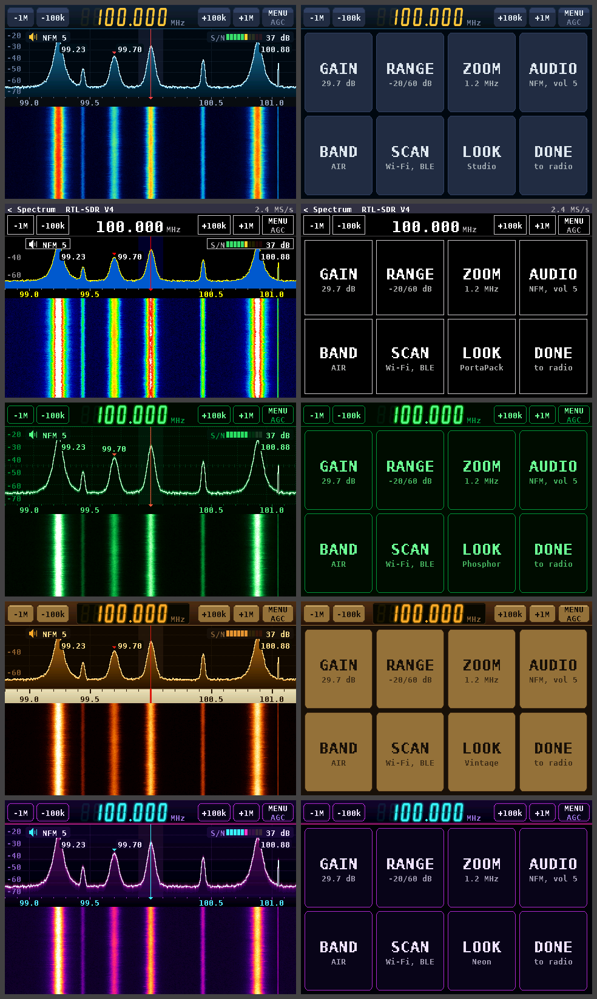
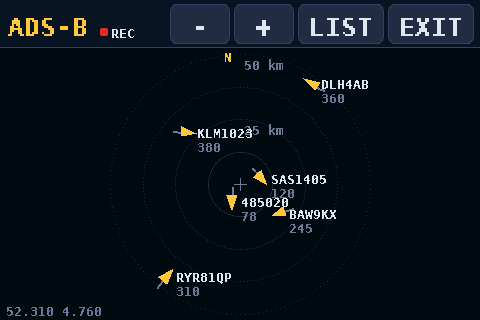
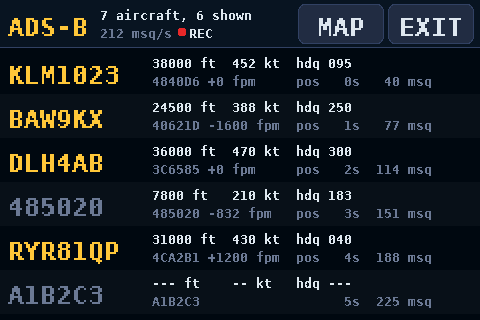
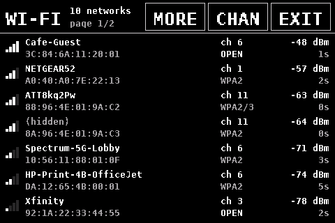
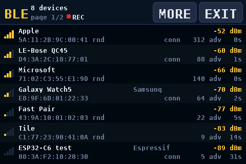
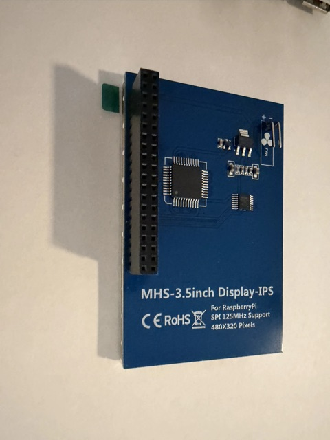
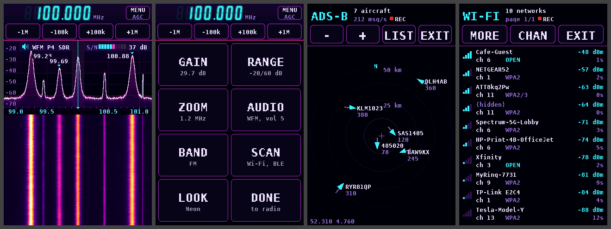

# P4 SDR: RTL-SDR receiver, ADS-B and Wi-Fi/BLE scanner on the ESP32-P4

**An RTL-SDR Blog V4 dongle, a Waveshare ESP32-P4 kit and the cheap 3.5" Raspberry Pi
touchscreen make a handheld spectrum and waterfall receiver. It has no Linux or PC behind it:
native ESP-IDF firmware drives the dongle over USB.**

Thank you to **John Stockdale**, whose [ADS-B Scope](https://github.com/jstockdale/T-Display-P4/tree/adsb)
gave P4 SDR its single-frame aircraft positions and jump checks. RTL-SDR.com wrote it up:
[Portable ADS-B receiver firmware for the LilyGO T-Display-P4](https://www.rtl-sdr.com/portable-ads-b-receiver-firmware-for-the-esp32-p4-based-lilygo-t-display-p4-with-rtl-sdr/).

> **Just want the 3.5" screen working on the P4?** Use
> [esp32-p4-3.5-inch-rpi-display](https://github.com/John-ODell/esp32-p4-3.5-inch-rpi-display).
> It holds the screen driver on its own, plus a small flash-and-test tool. It is MIT licensed
> and needs no dongle. This repository is the full radio tool built on that driver.

<p align="center"></p>

## What it does

- **Spectrum and waterfall** across 2.4 MHz of the RTL-SDR's range, with peak hold, a dB scale, a
  shaded passband and an S/N bar meter. Up to three strong signals elsewhere get a marker with their
  frequency. Tune by touch: tap a signal and it moves to the centre.
- **Audio** from the kit's speaker connector: broadcast FM (WFM), narrow FM and AM, with volume and
  squelch. A plate on the spectrum shows the mode and lights its speaker while sound plays.
- **Channel memories**: 8 slots, each a frequency and a mode, and a scanner that stops on activity.
- **RDS** on broadcast FM: the station's name replaces the volume on that plate, and the serial
  log gets the programme ID, name and RadioText.
- **ADS-B** at 1090 MHz: a list of aircraft (callsign, altitude, speed, heading, climb rate) and a
  map with range rings from 5 to 400 km. With a map file on a micro-SD card, the map also shows
  coastlines, lakes, rivers, borders, roads, runways, towns and airports. Positions update from
  single frames and are checked for impossible jumps, using the logic from John Stockdale's
  [ADS-B Scope](https://github.com/jstockdale/T-Display-P4/tree/adsb).
- **Wi-Fi scanner** on the module's ESP32-C6. It lists 2.4 GHz access points and has a channel
  view showing one hump per network.
- **BLE scanner**, also on the C6. It lists nearby devices with name, maker or service, address,
  signal and advert count.
- **Logging to the SD card**: with a card in, ADS-B, Wi-Fi and BLE write what they hear to CSV
  files you can open in a spreadsheet.
- **Five looks**: Studio, PortaPack, Phosphor, Vintage and Neon.
- **Landscape or portrait.** Portrait stands the kit up with its USB ports, and the dongle, at the
  top. Every screen has a portrait layout.
- Big touch keys made for a resistive panel. They light up under your finger and fire when you
  lift it. Settings are saved to flash.

<table align="center">
  <tr>
    <td></td>
    <td></td>
  </tr>
  <tr>
    <td></td>
    <td></td>
  </tr>
</table>

The screenshots come from `tools/preview` with made-up aircraft and neighbours.

## What you need

<table align="center">
  <tr>
    <td align="center"></td>
    <td align="center"></td>
  </tr>
  <tr>
    <td align="center">Waveshare ESP32-P4-Module-DEV-KIT</td>
    <td align="center">MHS-3.5inch Display-IPS (the tested screen)</td>
  </tr>
</table>

| Part | Notes |
|---|---|
| Waveshare **ESP32-P4-Module-DEV-KIT** | The module carries an ESP32-C6, which runs the Wi-Fi and BLE scanners. |
| **MHS-3.5inch Display-IPS** (480×320, ILI9486 commands over 16-bit SPI, XPT2046 resistive touch) | The tested screen. Plugs straight onto the kit's 40-pin header, pin 1 to pin 1. The older MPI3501 "3.5inch RPi Display" (four logic chips on the back) uses the same protocol but hasn't been tested. See [Is this my screen?](https://github.com/John-ODell/esp32-p4-3.5-inch-rpi-display#is-this-my-screen) |
| **RTL-SDR Blog V4** dongle and an antenna | It goes in one of the kit's USB-A ports. Set the **H3 jumper to HOST**. This is the only dongle tested so far. |
| A small speaker, 8 Ω (optional) | Plugs into the kit's 2-pin speaker connector (MX1.25), driven by the on-board ES8311 codec and NS4150B amplifier. |
| micro-SD card, FAT32 (optional) | Holds `MAP.BIN` for the ADS-B map, and the CSV logs. |

## Flash the prebuilt firmware

1. Connect the kit's **USB TO UART** Type-C port to your computer.
2. Find your chip revision:
   ```bash
   esptool.py --chip esp32p4 -p PORT flash_id
   ```
   The output contains `Chip is ESP32-P4 (revision vX.Y)`.
3. Download the matching image from the [latest release](https://github.com/John-ODell/esp32-p4-rtl-sdr/releases/latest):

   | Image | Boots on | Status |
   |---|---|---|
   | `p4-sdr-1.1.0-rev1.bin` | v1.x (early kits) | tested on v1.0 |
   | `p4-sdr-1.1.0-rev3.bin` | v3.1 and later | built, not tested on hardware |

4. Flash it:
   ```bash
   esptool.py --chip esp32p4 -p PORT -b 921600 write_flash 0x0 p4-sdr-1.1.0-rev1.bin
   ```
   `PORT` looks like `/dev/cu.usbmodem…` on macOS, `/dev/ttyACM0` on Linux, or `COM5` on Windows.
   The image is a full flash image, so it clears saved settings and the touch calibration.

Check downloads against `SHA256SUMS` on the release page. Web flashers can read
`workbench-manifest.json` from the same page. It lists each image's URL, flash address, size,
SHA-256 and the chip revisions it boots on.

## First boot

1. **Splash.** The splash is drawn in the saved look and plays a short tune-in animation. On first
   boot it runs the 5-point touch calibration: tap the centre of each cross.
   To redo it later, hold the screen during the splash.
2. **Dongle.** It looks for the RTL-SDR on the USB-A ports. If nothing shows up, check the H3
   jumper, then unplug the dongle and plug it back in.
3. **Link check.** A 1.5 s USB test in which the dongle sends a byte counter, so any lost byte is
   caught.
4. **Receiver.** It starts at 100.0 MHz, in the FM broadcast band, and after that at the last frequency used.

The serial console (USB TO UART, 115200 baud) logs fps, USB errors, the noise floor and the
sample rate every 5 s.

## Using it

| Where | Touch |
|---|---|
| header `-1M` `-100k` `+100k` `+1M` | step the frequency; hold to repeat |
| header frequency readout | next look |
| header `MENU` key (gain shown under it) | open the menu |
| spectrum or waterfall | tune to the spot where you lift your finger |

The menu is eight big tiles:

| Tile | Choices |
|---|---|
| **Gain** | -/+ through every tuner gain step, or AGC, 15, 30, MAX |
| **Range** | auto, or the top level and the span, -/+ in 5 dB steps |
| **Zoom** | 2.4 MHz, 1.2 MHz, 600 kHz, 300 kHz |
| **Audio** | the filter, which also picks the mode: WFM 200k, NFM 25k, NFM 12.5k, AM 8k. Volume -/+ (0 is off) and squelch -/+ (0 is open; each step asks for 3 dB more: on FM, of quieting, so a station already on the air opens it; on AM, of level above the noise it has heard) |
| **Band** | FM, AIR, MARINE, NOAA, 2M, PMR, 70CM, ADS-B |
| **Scan** | WiFi, BLE; **Save** stores the tuned channel (frequency and filter) in one of 8 memories; **Memory** tunes one, and its **Scan** key hops through them, stopping while the squelch is open and 2 s after. Any touch stops the scan. |
| **Look** | Studio, PortaPack, Phosphor, Vintage, Neon; **Turn** switches landscape and portrait |
| **Done** | back to the radio |

Every mode (ADS-B, Wi-Fi, BLE) takes over the whole screen and pauses the receiver. EXIT
starts the receiver again.

### Portrait

**Look › Turn** switches to portrait: hold the kit with its USB-A and Ethernet ports at the top. The
step keys move to a row under the frequency, the menu stands two tiles wide, and the ADS-B and
scanner keys sit in a row under their title. The choice is saved and used from the boot screen on.
Touch calibration is kept in landscape and turned in software, so no recalibration is needed.

<p align="center"></p>

## ADS-B map on a micro-SD card

The map is a small file made on a computer from Natural Earth data, plus OpenStreetMap detail
close in. Centre it near your antenna: the map's centre becomes home on the kit.

```bash
python3 tools/mapgen/make_map.py --place "Leeds, UK" --out /Volumes/SDCARD/MAP.BIN
python3 tools/mapgen/make_map.py --lat 52.31 --lon 4.76 --name SCHIPHOL --radius 300
```

- The tool uses the Python standard library only.
- The first run downloads about 27 MB of Natural Earth data into `~/.cache/p4-sdr-mapgen`.
- OpenStreetMap detail comes through the public Overpass API, which is often busy. When a query
  fails, the map is written without that layer, and running the tool again later fills it in.
  `--no-osm` skips Overpass altogether.
- Copy `MAP.BIN` to the root of a FAT32 card and put the card in the kit's slot.
- The card is read the first time ADS-B opens, and only then.

## Logs on the SD card

With a FAT32 card in the slot, each mode writes a CSV file to `LOGS/` on the card while it is open.
The header shows a red dot and **REC** while it records (just the dot where space is short), and
**SD ERR** if a write fails. Without a card, nothing changes.

| File | One row | Columns |
|---|---|---|
| `ADSBnnnn.CSV` | per aircraft, at most every 5 s, when heard since its last row | `t_s, icao, callsign, alt_ft, speed_kt, track_deg, vrate_fpm, lat, lon, msgs` |
| `WIFInnnn.CSV` | per network heard in each sweep (about every 2 s) | `t_s, bssid, ssid, channel, rssi_dbm, security` |
| `BLEnnnn.CSV` | per device heard in the last 5 s | `t_s, address, address_type, rssi_dbm, name, maker_or_service, connectable, adverts` |

- `nnnn` is a session number that goes up by one at each power-on. Opening a mode again during
  the same session adds to its file.
- `t_s` is seconds since power-on. The kit has no clock, so the files carry no dates, and the card
  shows them as made in 1980.
- Fields not heard yet are empty. Text fields are quoted.
- Sizes measured on the kit: ADS-B about 0.2 MB an hour with 8 aircraft in view (it grows
  with traffic), and Wi-Fi about 4 MB an hour with 45 networks in range.
- A low-priority task writes the rows and syncs the card every 2 s. Pulling the card loses at
  most the last 2 s.

## Build from source

You need ESP-IDF **v5.5** (tested with v5.5.5).

```bash
. $IDF_PATH/export.sh
idf.py build                                  # chip v3.1 and later
idf.py -p PORT -b 921600 flash monitor
```

For a v1.x chip, add `sdkconfig.rev1` to the defaults. Defaults only apply when `sdkconfig` is
created, so start from a clean one:

```bash
rm -f sdkconfig
idf.py -D SDKCONFIG_DEFAULTS="sdkconfig.defaults;sdkconfig.rev1" build
```

The component manager fetches `esp_hosted`, `esp_wifi_remote` and `esp_codec_dev` on the first
build. The first two are the C6 link and the third drives the speaker codec. The versions are
pinned in `dependencies.lock`. `tools/build_release.sh` builds both chip-revision images into
`dist/`, along with `SHA256SUMS` and the Workbench manifest.

`tools/preview` builds the drawing code on a Mac or Linux PC, feeds it fake stations,
aircraft and neighbours, and writes a PNG of every screen in every look, landscape and then
portrait (`portrait-*.png`).
`tools/adsb_test` runs the ADS-B decoder against known messages. `tools/demod_test` runs the audio
demodulator on synthesized FM and AM stations (with a neighbour and a stereo pilot) and checks the
tone that comes out and the squelch. It also builds a broadcast station with RDS groups and
checks the decoded ID, name and RadioText, with the station's clock up to 100 ppm off.
`tools/capture_log.py PORT SECONDS` resets the kit and prints its serial log. With `--attach` it
leaves the board running and reattaches if the USB serial port drops out, which suits long runs.

## Code

| File | Job |
|---|---|
| `main/main.c` | boot, splash, calibration, link check |
| `main/sdr.c` | dongle open, tune and gain; `read_async` into a 1 MB PSRAM IQ ring |
| `main/spectrum.c` | Hann window, FFT of 1024 to 4096 points (set by zoom), averaged per frame |
| `main/view.c`, `main/panel.c` | all receiver and menu drawing, in five looks and both orientations (no ESP-IDF calls) |
| `main/ui.c` | receiver loop, touch tracker, saved settings, stream recovery, mode switching |
| `main/demod.c` | audio demodulator: CIC decimation to 480 kS/s, WFM, NFM or AM, 48 kHz out, squelch (no ESP-IDF calls) |
| `main/rds.c` | RDS: 57 kHz down-mix, bit timing, block sync, station name and RadioText (no ESP-IDF calls) |
| `main/dsp.c` | the FIR filters and atan2 that `demod.c` and `rds.c` share |
| `main/audio.c` | ES8311 codec, I2S, and the task that feeds the demodulator from the IQ ring |
| `main/adsb.c`, `main/adsb_view.c` | ADS-B demodulator and decoder; list and map screens |
| `main/amap.c`, `main/sdcard.c` | SD-card base map (format in `amap.h`); shared card mount |
| `main/sdlog.c` | CSV logs: PSRAM ring, writer task, per-boot file numbering |
| `main/radio_scan.c`, `main/scan_view.c` | Wi-Fi and BLE scanning on the C6; their screens |
| `components/rtlsdr` | librtlsdr (RTL-SDR Blog fork, unmodified) on a small libusb shim over the ESP-IDF USB host |
| `components/rpi_display` | screen, text, off-screen canvas, touch and calibration (the driver from the screen repo) |
| `tools/mapgen` | `make_map.py`, which makes `MAP.BIN` |
| `tests/stage1_stream_test.c` | 20 s USB counter and sample test (copy it over `main/main.c` to run) |

Core 0 runs the USB host, the IQ stream and the audio demodulator. Core 1 runs the FFT, drawing and touch.

## Measured (chip v1.0, RTL-SDR Blog V4)

- The dongle enumerates at USB high speed through the kit's CH334F hub.
- Counter test, 20 s at 2.4 MS/s: 4.80 MB/s, **0 bytes lost**, 0 USB errors.
- Receiver: 9.8 fps at FFT 1024 and 9.4 fps at FFT 4096. The IQ stream runs at 4.80 MB/s with
  0 USB errors.
- Wi-Fi: 29 networks in 5 sweeps of about 2 s each. BLE: 13 devices in 10 s. The receiver comes
  back at 9.8 fps afterwards.
- SD logging: a 14-minute ADS-B log of 24 aircraft (815 rows) had no gap over 5 s, and the decoder
  stayed at 22% load with 0 bytes dropped. Wi-Fi logged 88 networks and BLE 40 devices. The
  receiver came back at 10.1 fps.
- Long run, one boot, card in, logging on: 18 min on the receiver, 3.5 min of Wi-Fi, 6 min of BLE,
  then 44 min of ADS-B. All 530 ADS-B reports showed 22% decoder load and 0 bytes dropped, with
  free internal RAM flat at 58 KB. The ADS-B log has 1,221 rows (51 aircraft), and its only long
  gaps are times when nothing was heard. Every log closed with 0 rows dropped.
- ADS-B single-frame positions on live aircraft (logic from John Stockdale's
  [ADS-B Scope](https://github.com/jstockdale/T-Display-P4/tree/adsb)): a 38-minute log of
  53 aircraft. In 86% of a plane's back-to-back 5-second rows its position had moved, against 69%
  and 76% in two logs from before the port. No position jumped. For the 18 minutes the serial log
  covered, the decoder stayed at 22% load with 0 bytes dropped. The logs are from different days with different traffic, so treat the
  comparison as rough.
- Audio demodulator, timed on core 0 with nothing else running: WFM (with RDS) 41% of real time,
  NFM 27%, AM 35%. On the receiver with the V4 streaming, WFM showed 43 to 44% for a minute, lag
  under 20 ms, no task watchdog, and the spectrum held 9.6 fps.
- Internal RAM: 75 KB free on the receiver at boot. The first Wi-Fi or BLE visit costs 11 KB once
  (the C6 link stays up), leaving 64 KB. Later visits return to the same figure, and the low-water
  mark held at 43 KB. The receiver and ADS-B lines in the serial log report this every 5 s.

## Limits

- **Audio has not been heard yet.** The demodulator passes its host test and runs on the kit (WFM
  at 43% of core 0, see "Measured"), but nobody has listened to it on a speaker yet.
  FM is mono, because the kit has one speaker output. RDS has only been decoded from synthesized
  stations so far.
- Tested only with the RTL-SDR Blog V4 and on chip revision v1.0. The rev3 image is built but has
  not been run on hardware.
- Portrait has been checked in `tools/preview` only. On the kit, that it comes out the right way up
  and that touches land in place are still to be confirmed.
- Wi-Fi scanning covers 2.4 GHz only, because the C6 has no 5 GHz radio.
- The kit's USB-A power is always on, so software cannot power-cycle a hung dongle. Unplug it and
  plug it back in.
- The `E USBH: Dev 1 EP 0 STALL` lines when the dongle opens come from librtlsdr probing other
  tuner types. They are harmless.

## License

GPL-3.0-or-later; see [LICENSE](LICENSE). librtlsdr is GPL-2.0-or-later, and firmware that links
it must be under the GPL. GPLv3 is used because it can be combined with ESP-IDF's Apache-2.0 code
and GPLv2 cannot. Third-party parts and their licenses are listed in [THIRD_PARTY.md](THIRD_PARTY.md).

Map data © OpenStreetMap contributors (ODbL) and Natural Earth (public domain).
